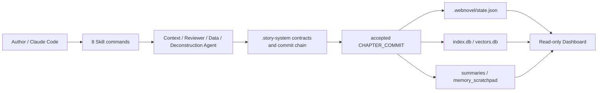

# Webnovel Writer

**Using the DeepSeek Harness writing workspace (v8)? [🌐 Product website](https://lingfengqaq.github.io/webnovel-writer/) · [📖 Beginner tutorial](https://lingfengqaq.github.io/webnovel-writer/docs/beginner.html) · [Installation guide](https://lingfengqaq.github.io/webnovel-writer/docs/install.html)**

This `ntense` branch is the English-first fork of the Claude Code edition (v6), maintained in `ezhomelabs/webnovel-writer`. Use the branch-pinned Quick Start below, not the upstream/default-branch installer. The v8 links above refer to the separate upstream product, not this fork.

[](LICENSE)
[](.claude-plugin/marketplace.json)
[](https://www.python.org/)
[](https://claude.ai/claude-code)
[](.claude-plugin/marketplace.json)

<a href="https://trendshift.io/repositories/22487" target="_blank"></a>

A long-form webnovel writing plugin for Claude Code. It connects the entire creative workflow: initialize settings, plan volume outlines, write and review chapters, retain memories, query state, and browse a read-only visual dashboard.

It addresses one central problem: **help AI remember the setting, resolve foreshadowing, and follow the outline even after hundreds of chapters.**

In short, this is a consistency system for long-running serial fiction, not a one-off generator that forgets what it wrote.

> **Version guide (updated 2026-10-06)**
>
> | Branch | Version | Status |
> |---|---|---|
> | `ntense` (this fork) | v6 · English Claude Code plugin | English defaults, legacy-project compatibility, and portable host adapters |
> | `master` (upstream) | v6 · Claude Code plugin | Maintenance mode (critical bugs only); Claude Code users should use this edition |
> | `v7` | v7 · Multi-host CLI rewrite | Frozen and unreleased; retained as a development archive |
> | [v8](https://github.com/lingfengQAQ/webnovel-writer/tree/v8) | v8 · Writing workspace based on [DeepSeek Harness](https://www.deepseek.com/harness/) | Stable release; [product website and tutorials](https://lingfengqaq.github.io/webnovel-writer/) |
>
> Feedback collected for the original v7 design proposal ([Discussions #118](https://github.com/lingfengQAQ/webnovel-writer/discussions/118)) remains important input for v8. Following evaluation, the v7 CLI will not be released; the next generation instead uses a dsh plugin. v8 publishes its product source, runtime skills, and tutorials; internal development discussions and private writing materials are not public. v6 and v8 have different installation methods, and no direct migration path for existing book repositories has been verified.

## Why You Need It

The hardest part of long-form writing is not the first chapter. It is maintaining the following beyond chapter 80 or 200:

- Consistent character motivations
- Compatible power levels, timelines, locations, and world rules
- Recorded, developed, and resolved foreshadowing
- Well-paced payoffs, relationships, and worldbuilding
- Searchable facts recorded after each chapter

This system turns those constraints into steps Claude Code executes automatically: consult reference material before writing, record new facts afterward, check consistency, and synchronize the latest state into retrieval indexes, chapter summaries, long-term memory, and the Dashboard. It does not merely write; it builds a durable record as it goes.

## Core Capabilities

| Capability | Command | Description |
|------|------|------|
| Deep initialization | `/webnovel-init` | Staged questions establish the book's structure, setting bible, master outline, and initial state |
| Volume planning | `/webnovel-plan` | Break the master outline into volumes and chapters, fill in timelines, and persist new settings |
| Chapter writing | `/webnovel-write` | Complete a chapter end to end: context, draft, review, polish, fact recording, and automatic backup |
| Quality review | `/webnovel-review` | Review payoffs, consistency, pacing, out-of-character behavior, continuity, and reader retention |
| State queries | `/webnovel-query` | Query characters, foreshadowing, pacing, entity relationships, and runtime information |
| Project learning | `/webnovel-learn` | Save effective techniques from this book in project long-term memory |
| Visual dashboard | `/webnovel-dashboard` | Browse project state, entity graphs, chapters, and reader-retention data read-only |
| Project health check | `/webnovel-doctor` | Phase-aware checks of directories, files, databases, RAG, dependencies, and Dashboard artifacts |

## English projects and other hosts

New books use `chapters/`, `outlines/`, `settings/`, and `reviews/`, with English
starter files, prompts, CLI reports, and dashboard labels. Existing Chinese book
layouts remain readable and are not automatically renamed. Internal legacy schema
values and compatibility fixtures are retained; these are not translated in place.
English prose uses word counts rather than character counts. See the
[English compatibility guide](docs/english-compatibility.md) for filenames,
reference retrieval, and preserved internal identifiers.

For **Codex and Antigravity**, see the [project-local skill adapters](integrations/README.md).
These reuse the engine without changing the Claude Code plugin. The adapter
layout was informed by [ezhomelabs/antigravity-webnovel-writer](https://github.com/ezhomelabs/antigravity-webnovel-writer/); see its [design credit](integrations/README.md#design-references). They are portable
skills, not native hook/plugin parity. Mandatory independent review still requires
real host subagent support; unsupported gated workflows stop rather than pretend
to have completed review. Host/model writing quality needs separate validation.

## System Overview



The default mainline in v6.0.0 is **Story System**. Its key components are:

- `.story-system/`: the single source of truth, storing pre-writing contracts and post-writing commits
- An accepted `CHAPTER_COMMIT`: records new facts after a chapter is complete
- `.webnovel/state.json`, `index.db`, `summaries/`, and `memory_scratchpad.json`: derived read-only views for queries and display
- `.webnovel/projection_log.jsonl`: projection execution logs for diagnosing synchronization failures in state, index, summary, memory, or vector data
- `project-status`, `doctor`, `preflight`, and the Dashboard: expose mainline and runtime status so problems are visible immediately

## Quick Start

### 1. Install the Plugin

Install this English fork through the Claude Code Marketplace (requires an existing Claude Code installation with branch-ref support):

```bash
claude plugin marketplace add "ezhomelabs/webnovel-writer#ntense" --scope user
claude plugin install webnovel-writer@ntense-webnovel-writer --scope user
```

The quoted `#ntense` pins the marketplace to this branch; do not omit it. The distinct marketplace name avoids replacing the upstream catalog. If the upstream plugin is already enabled, disable that copy in `/plugin` before using this edition to avoid duplicate `webnovel-writer` commands.

Replace `--scope user` with `--scope project` in both commands to install only for the current project.

Verify the selected source with `claude plugin marketplace list --json`: it should show `ezhomelabs/webnovel-writer` and ref `ntense`.

> For installation, enabling, and everyday management, see the official Claude Code documentation: [plugins](https://docs.claude.com/en/docs/claude-code/plugins) · [plugin marketplaces](https://docs.claude.com/en/docs/claude-code/plugin-marketplaces).

### 2. Install Python Dependencies

```bash
git clone --branch ntense --single-branch https://github.com/ezhomelabs/webnovel-writer.git webnovel-writer-ntense
cd webnovel-writer-ntense
python3 -m venv .venv
source .venv/bin/activate
python -m pip install -r requirements.txt
```

Run these commands in a terminal with Python 3.10+ (macOS/Linux). On Windows PowerShell, create the environment with `py -3 -m venv .venv` and activate it with `.venv\Scripts\Activate.ps1`. The local requirements file includes the scripts and Dashboard requirements from the same `ntense` checkout; do not substitute an upstream `HEAD` URL.

Keep the virtual environment active when launching `claude`, so the plugin hooks and scripts use these dependencies. Start Claude Code from your book workspace, outside the plugin source directory.

### 3. Initialize a Book

Enter this in Claude Code:

```bash
/webnovel-init
```

Initialization creates a book project directory containing:

```text
project-root/
├── .story-system/        # Contracts, chapter commits, and event audits
├── .webnovel/            # State, indexes, summaries, backups, and long-term memory
├── chapters/             # Chapter text
├── outlines/             # Master, volume, timeline, and chapter outlines
├── settings/             # Worldbuilding, characters, power systems, and other settings
└── reviews/              # Chapter review reports
```

New projects use the English directory names shown above. Existing books using `正文/`, `大纲/`, `设定集/`, and `审查报告/` remain supported: tools resolve their actual directories and do not rename files or create parallel copies. The corresponding pairs are `chapters` / `正文`, `outlines` / `大纲`, `settings` / `设定集`, and `reviews` / `审查报告`.

New books also use English filenames, for example `outlines/master-outline.md`, `settings/worldbuilding.md`, `chapters/chapter-0001.md`, and `reviews/chapter-1-review.md`. Existing filenames such as `总纲.md`, `世界观.md`, and `第0001章.md` remain supported without renaming. Generated prose and author-facing reports default to English unless requested otherwise.

Inspect a book's resolved directories with:

```bash
python "<CLAUDE_PLUGIN_ROOT>/scripts/project_paths.py" --project-root "<BOOK_PROJECT_ROOT>"
```

Use those returned paths for an existing project rather than manually substituting English names. If both forms of a directory exist, do not merge or overwrite them automatically; inspect the contents first.

### 4. Configure RAG

In the book project's root directory, copy `.env.example` to `.env` and fill in your API keys:

```bash
cp .env.example .env
```

Minimal configuration:

```bash
EMBED_BASE_URL=https://api-inference.modelscope.cn/v1
EMBED_MODEL=Qwen/Qwen3-Embedding-8B
EMBED_API_KEY=your_embed_api_key

RERANK_BASE_URL=https://api.jina.ai/v1
RERANK_MODEL=jina-reranker-v3
RERANK_API_KEY=your_rerank_api_key
```

The system also works without an embedding key: it automatically falls back to BM25 keyword retrieval, with weaker semantic recall. Both embedding and reranking can use any compatible OpenAI-format endpoint.

### 5. Start Planning and Writing

```bash
/webnovel-plan 1      # Plan volume 1
/webnovel-write 1     # Write chapter 1
/webnovel-review 1-5  # Review chapters 1–5
/webnovel-query foreshadowing  # Query project foreshadowing state
```

### 6. Open the Dashboard

```bash
/webnovel-dashboard
```

The Dashboard is read-only and displays project status, entity relationships, chapters, foreshadowing, and reader-retention data. Its frontend is prebuilt and shipped with the plugin; no local `npm build` is needed.

## Chapter Writing Workflow

`/webnovel-write` is not a single generation request. It is a complete gated pipeline:

1. Preflight the project root, placeholders, and Story System health
2. Refresh the chapter's runtime contract
3. Call `context-agent` to produce the writing brief
4. Draft the chapter from the brief
5. Call `reviewer` for multidimensional review; unresolved blocking issues stop progress
6. Polish, format, and run the final Anti-AI check
7. Call `data-agent` to extract facts
8. Generate `CHAPTER_COMMIT` and project state, index, summary, memory, and vector updates
9. Create a chapter-level backup

This separates how a chapter is written from what happened in it. Prose and pacing have creative freedom, but established facts must be recorded, reviewed, and archived unambiguously.

### Reading the Final Report

`/webnovel-init`, `/webnovel-plan`, `/webnovel-write`, and `/webnovel-review` finish with an author-facing report rather than raw internal JSON, tracebacks, or lengthy command logs. It starts with an overall status:

- **Completed**: required artifacts and key checks passed; proceed to the next step.
- **Partially completed**: main artifacts were retained, but some steps were skipped, automatically handled, or need minor confirmation.
- **Action required**: the system stopped safely and needs a decision about creative direction, conflicting facts, file overwrites, or blocking issues.
- **Not completed**: essential artifacts were not reliably generated; rerun or investigate using the report's recovery advice.

Three sections follow: generated files and completion status; issues and unusually long steps; and recommended next steps. Automatically resolved issues are also disclosed, such as a projection that succeeded on retry. Only unrecoverable failures direct you to `.webnovel/logs/run_last.log`.

During execution, a few progress messages explain the current step and expected output. Questions are limited to creative direction, factual consistency, overwrite risks, and blocking issues. Repeating `/webnovel-write <chapter-number>` first checks trustworthy checkpoints and resumes from the failure where possible, without repeating reliably completed drafting, review, commits, or backups.

## Built-in Genres

Includes 37 Chinese webnovel genre templates and supports combining genres. A selection:

| Category | Examples |
|------|----------|
| Fantasy and cultivation | Cultivation, system fiction, martial progression, Western fantasy, infinite-flow, apocalypse, science fiction |
| Modern and urban | Urban superpowers, everyday urban life, high-concept urban fiction, realism, esports, livestreaming |
| Romance | Historical romance, palace and household intrigue, sweet young romance, billionaire romance, melodrama, substitute romance, farming |
| Specialty genres | Rule-based horror, mystery concepts, supernatural mystery, historical fiction, wartime espionage, Zhihu short fiction, cosmic horror |

See the [genre template guide](docs/guides/genres.md) for the complete list.

## Command Reference

### Claude Code Skill Commands

| Command | Example | Purpose |
|------|------|------|
| `/webnovel-init` | `/webnovel-init` | Initialize a new book project |
| `/webnovel-plan` | `/webnovel-plan 1` | Generate volume outlines, timelines, and chapter outlines |
| `/webnovel-write` | `/webnovel-write 45` | Write and commit a specified chapter |
| `/webnovel-review` | `/webnovel-review 1-5` | Review a range of chapters |
| `/webnovel-query` | `/webnovel-query Alex` | Query characters, foreshadowing, state, and other information |
| `/webnovel-learn` | `/webnovel-learn "This hook design works well"` | Record project experience in memory |
| `/webnovel-dashboard` | `/webnovel-dashboard` | Launch the read-only visual dashboard |
| `/webnovel-doctor` | `/webnovel-doctor --chapter 12` | Read-only health checks for project files, databases, RAG, and dependencies |

### CLI Entry Point

All command-line tools use `scripts/webnovel.py`:

```bash
python -X utf8 "<CLAUDE_PLUGIN_ROOT>/scripts/webnovel.py" --project-root "<PROJECT_ROOT>" <subcommand> [arguments]
```

Common subcommands:

| Subcommand | Description |
|--------|------|
| `where` | Print the resolved book project root |
| `preflight` | Validate plugin paths, project root, and Story System health |
| `project-status` | Output concise machine-readable status, phase, and next step |
| `doctor` | Phase-aware health checks with impact and repair advice |
| `write-gate` | Validate before writing, before committing, and after committing |
| `projections` | Retry or replay projections from existing commits |
| `story-system` | Generate contract seeds and runtime contracts |
| `chapter-commit` | Commit chapter facts and drive projections |
| `story-events` | Query chapter events or check event-chain health |
| `memory` | View, query, export, and backfill long-term memory |
| `rag` | Manage vector indexes and retrieval status |
| `status` | Output a project health report |

See the [detailed command guide](docs/guides/commands.md) for more.

## Documentation

| Document | Contents |
|------|------|
| [Documentation center](docs/README.md) | Complete index and recommended reading order |
| [Architecture and modules](docs/architecture/overview.md) | Core concepts, agent responsibilities, and Story System design |
| [Command guide](docs/guides/commands.md) | Skill commands and CLI subcommands |
| [RAG and configuration](docs/guides/rag-and-config.md) | Retrieval flow, environment variables, and default models |
| [Genre templates](docs/guides/genres.md) | 37 templates and composite-genre rules |
| [Project structure and operations](docs/operations/operations.md) | Directory layout, health checks, backup, and recovery |
| [Plugin releases](docs/operations/plugin-release.md) | Marketplace release and version synchronization |

## Development and Testing

Clone the repository and install dependencies:

```bash
python -m pip install -r requirements.txt
python -m pip install -r webnovel-writer/scripts/requirements.txt
```

Run tests:

```bash
python -m pytest
```

The Dashboard frontend lives in `webnovel-writer/dashboard/frontend/`. Releases include prebuilt `dist/` artifacts. For frontend development, enter that directory and run:

```bash
npm install
npm run dev
```

## Troubleshooting

Start with preflight checks:

```bash
python -X utf8 "<CLAUDE_PLUGIN_ROOT>/scripts/webnovel.py" --project-root "<PROJECT_ROOT>" preflight
python -X utf8 "<CLAUDE_PLUGIN_ROOT>/scripts/webnovel.py" --project-root "<PROJECT_ROOT>" doctor --format text
```

Check that:

- `story_runtime.mainline_ready` is true
- `.story-system/commits/chapter_XXX.commit.json` exists and is accepted
- Every `projection_status` is `done` or `skipped`
- `index.db`, `summaries/`, and `memory_scratchpad.json` were generated correctly
- RAG API keys are configured in `.env` at the book project root

See [project structure and operations](docs/operations/operations.md) for more.

## Contributing

Issues and PRs are welcome. Use the repository templates to provide reproduction steps, environment details, impact, and verification methods. Remove private information first.

Suggested workflow:

```bash
git checkout -b feature/your-feature
git commit -m "feat: add your feature"
git push origin feature/your-feature
```

Useful areas for contributions:

- New genre templates and rules
- Stronger chapter review dimensions
- Dashboard information architecture and visualization
- RAG retrieval, entity disambiguation, and long-term memory
- Windows/macOS/Linux compatibility
- Documentation, example projects, and beginner tutorials

## Release Highlights

The current-release marker `(当前)` is retained for compatibility with the version synchronization tool.

| Version | Main changes |
|------|----------|
| **v6.2.1 (当前)** | Fix intermittent Windows chapter-commit access denial (WinError 5): automatically retry briefly locked data files |
| **v6.2.0** | Clearer writing results and better recovery after failure |
| **v6.1.0** | Runtime hardening: doctor/project-status/write-gate/projection replay, hooks, behavioral evals, and release checks |
| **v6.0.0** | Full Story System pipeline: contract seeds, runtime contracts, chapter commits, event audits, and integration tests |
| **v5.5.5** | Closed-loop long-term memory: pre-writing injection, post-writing retention, and the `memory` operations command |
| **v5.5.4** | Stronger writing-chain prompt constraints and standardized Chinese review/report wording |
| **v5.5.3** | Unified `preflight` command and Windows terminal encoding fixes |
| **v5.5.2** | Synchronize outline chapter titles with chapter filenames |
| **v5.5.1** | Fix volume-level outline context extraction; complete Dashboard and Learn documentation |
| **v5.5.0** | New read-only visual Dashboard with live refresh |
| **v5.4.4** | Plugin Marketplace installation support |
| **v5.4.3** | Smarter RAG context with `auto/graph_hybrid` fallback to BM25 |
| **v5.3** | Reader-retention system: hooks, payoffs, micro-payoffs, and narrative-debt tracking |

## License

This project is licensed under [GPL v3](LICENSE).

## Star History

[](https://star-history.com/#lingfengQAQ/webnovel-writer&Date)

## Acknowledgments

Developed through Vibe Coding with Claude Code, Gemini CLI, and Codex.

Inspiration: [Linux.do discussion](https://linux.do/t/topic/1397944/49)

Thanks to `oh-story-claudecode` for its story-deconstruction workflow reference.
