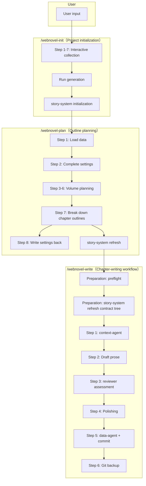
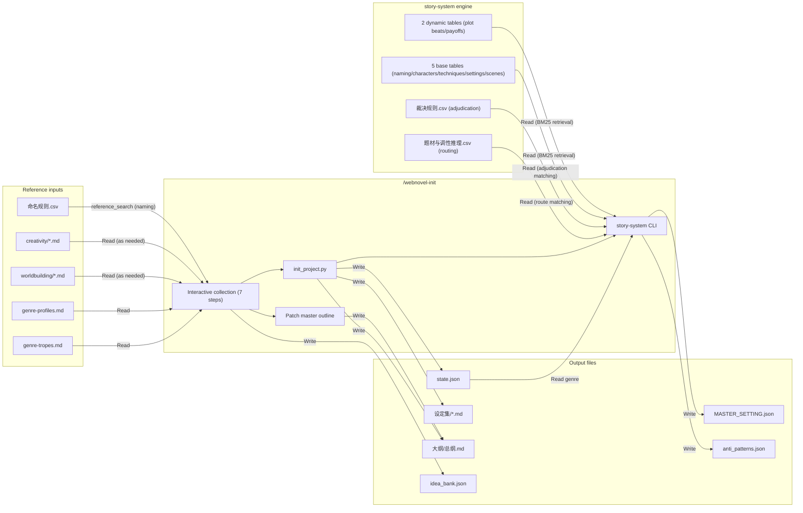
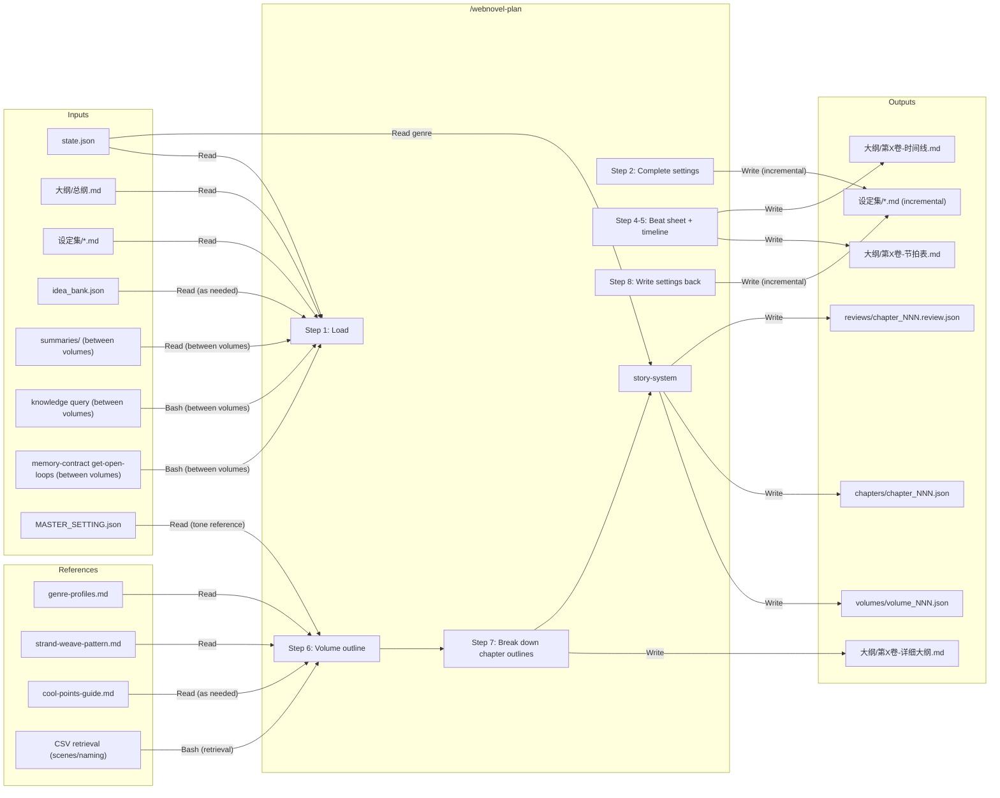
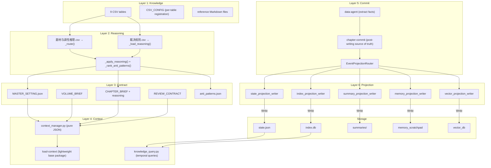
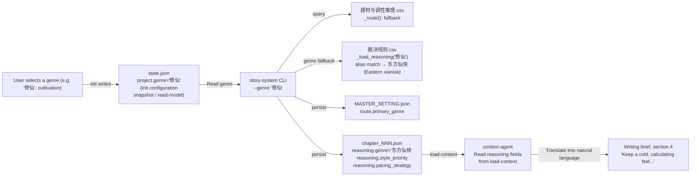

# Webnovel Writer System Architecture Diagrams

> Historical design record: project-directory examples retain their original names. New projects use `chapters/`, `outlines/`, `settings/`, and `reviews/`; existing legacy projects remain supported without renaming. Resolve actual paths with `scripts/project_paths.py` before using these examples.

> Generated: 2026-04-15
> Scope: read/write relationships across the complete init → plan → write pipeline

## Overall Pipeline

## Init Read/Write Flow

## Plan Read/Write Flow

## Write Read/Write Flow (Core Pipeline)

```mermaid
graph TB
    subgraph PREP["Preparation"]
        PRE1["preflight + where"]
        PRE2["story-system CLI"]
    end

    subgraph STEP1["Step 1: context-agent (subagent)"]
        CA_LOAD["load-context"]
        CA_READ["Read original chapter outline"]
        CA_QUERY["query-entity / query-rules as needed"]
        CA_OUT["Output: writing brief"]
    end

    subgraph STEP2["Step 2: Draft prose"]
        S2_WRITE["Write prose"]
        S2_CSV["reference_search (as needed)"]
    end

    subgraph STEP3["Step 3: reviewer (subagent)"]
        REV_READ["Read prose"]
        REV_CONTRACT["Read review contract"]
        REV_OUT["Write review_results.json"]
        REV_PIPE["review-pipeline --save-metrics"]
    end

    subgraph STEP4["Step 4: Polishing"]
        S4_REF["Read polish-guide / typesetting / style-adapter"]
        S4_EDIT["Edit prose"]
    end

    subgraph STEP5["Step 5: data-agent + commit"]
        DA_READ["Read prose"]
        DA_ENTITY["Bash: get-core-entities / recent-appearances"]
        DA_ARTIFACTS["Write 4 artifacts"]
        COMMIT["chapter-commit CLI"]
        PROJ["projection writers x5"]
    end

    subgraph STEP6["Step 6: Git"]
        GIT["git add + commit"]
    end

    %% Data stores
    subgraph STORES["Data stores"]
        ST_STATE["state.json (state)"]
        ST_INDEX["index.db (entities/relationships)"]
        ST_SUMMARY["summaries/chNNNN.md (summaries)"]
        ST_MEMORY["memory_scratchpad.json (memory)"]
        ST_VECTOR["vector_db (vector index)"]
        ST_COMMIT["commits/chapter_NNN.commit.json (post-writing source of truth)"]
        ST_CHAPTER["正文/第NNNN章.md"]
        ST_TMP["tmp/*.json (intermediate artifacts)"]
    end

    subgraph CONTRACTS["Contract tree (.story-system/)"]
        CT_MASTER["MASTER_SETTING.json"]
        CT_VOLUME["volumes/volume_NNN.json"]
        CT_CHAPTER["chapters/chapter_NNN.json"]
        CT_REVIEW["reviews/chapter_NNN.review.json"]
        CT_ANTI["anti_patterns.json"]
    end

    subgraph OUTLINE["Outline"]
        OL_DETAIL["大纲/第X卷-详细大纲.md"]
    end

    subgraph CSV["CSV knowledge layer"]
        CSV_R["题材与调性推理.csv (routing)"]
        CSV_J["裁决规则.csv (adjudication)"]
        CSV_ALL["7 base + dynamic tables"]
    end

    subgraph REFS["Polishing references"]
        REF_POLISH["polish-guide.md"]
        REF_TYPE["typesetting.md"]
        REF_STYLE["style-adapter.md"]
    end

    %% Preparation
    ST_STATE -->|"Read genre"| PRE2
    CSV_R -->|"Read (routing)"| PRE2
    CSV_J -->|"Read (adjudication)"| PRE2
    CSV_ALL -->|"Read (BM25)"| PRE2
    PRE2 -->|"Write"| CT_MASTER
    PRE2 -->|"Write"| CT_VOLUME
    PRE2 -->|"Write"| CT_CHAPTER
    PRE2 -->|"Write"| CT_REVIEW
    PRE2 -->|"Write"| CT_ANTI

    %% Step 1
    PRE2 --> CA_LOAD
    CA_LOAD -->|"Bash: load-context"| ST_STATE
    CA_LOAD -.->|"includes contracts"| CT_MASTER
    CA_LOAD -.->|"includes summaries"| ST_SUMMARY
    CA_LOAD -.->|"includes protagonist"| ST_STATE
    CA_LOAD -.->|"includes loops"| ST_STATE
    CA_READ -->|"Read"| OL_DETAIL
    CA_QUERY -->|"Bash (as needed)"| ST_INDEX
    CA_OUT -->|"Output brief"| STEP2

    %% Step 2
    S2_CSV -->|"Bash: reference_search"| CSV_ALL
    S2_WRITE -->|"Write"| ST_CHAPTER

    %% Step 3
    REV_READ -->|"Read"| ST_CHAPTER
    REV_CONTRACT -->|"Read"| CT_REVIEW
    REV_OUT -->|"Write"| ST_TMP
    REV_PIPE -->|"Bash + Write index.db"| ST_INDEX

    %% Step 4
    S4_REF -->|"Read"| REF_POLISH
    S4_REF -->|"Read"| REF_TYPE
    S4_REF -->|"Read"| REF_STYLE
    S4_EDIT -->|"Edit"| ST_CHAPTER

    %% Step 5
    DA_READ -->|"Read"| ST_CHAPTER
    DA_ENTITY -->|"Bash"| ST_INDEX
    DA_ARTIFACTS -->|"Write x4"| ST_TMP
    ST_TMP -->|"Read artifacts"| COMMIT
    COMMIT -->|"Write"| ST_COMMIT

    %% Projection
    COMMIT --> PROJ
    PROJ -->|"Write state_deltas"| ST_STATE
    PROJ -->|"Write entity_deltas"| ST_INDEX
    PROJ -->|"Write summary_text"| ST_SUMMARY
    PROJ -->|"Write memory_facts"| ST_MEMORY
    PROJ -->|"Write event+delta chunks"| ST_VECTOR

    %% Step 6
    PROJ --> GIT
```

## Six-Layer Mainline Overview

## Genre Data Flow

